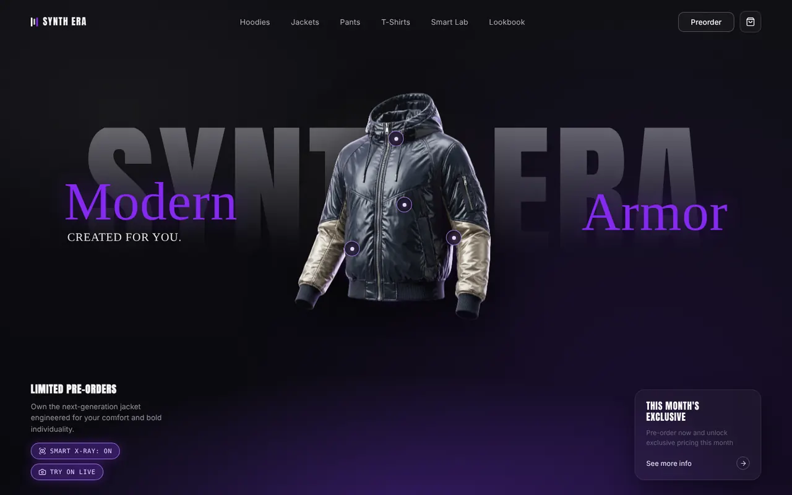

# SYNTH ERA — Modern Armor

Techwear brand store with AI virtual try-on.

**Live demo:** https://synth-era-armor.surge.sh



## Features

- AI virtual try-on from a photo — Leffa, with IDM-VTON and Nymbo as fallbacks
- Real-time video try-on through the Decart SDK
- “Smart X-Ray” garment detail view
- Hoodies, jackets, pants and tees with a lookbook
- Pre-order flow and cart

## Tech stack

React 18 · TypeScript · Vite · Gradio client · Decart SDK

## Run it locally

```bash
npm install
cp .env.example .env   # add your VITE_DECART_API_KEY (optional)
npm run dev
```

> The photo try-on endpoint (`/api/tryon`) runs inside the Vite dev server, so use `npm run dev` to try it. A free Hugging Face token (`HF_TOKEN`) gives priority GPU access.

---

Built by [Seif Sarhan](https://seifsarhan.github.io) · [GitHub](https://github.com/seifsarhan)
